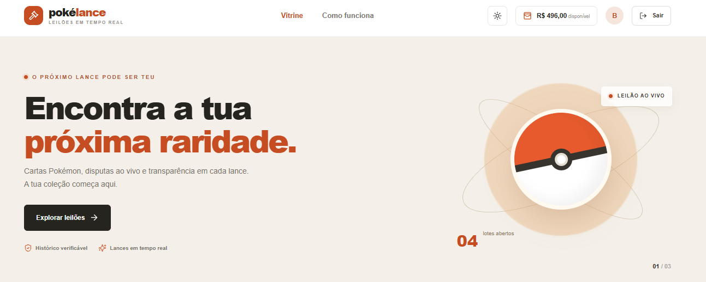

# PokéLance — Frontend

Interface web do PokéLance para acompanhar leilões Pokémon, criar lotes, realizar lances e consultar relatórios. A aplicação usa React, TypeScript, Vite e Socket.IO Client.



## Funcionalidades da interface

- Vitrine de lotes abertos com busca, detalhes e contagem regressiva.
- Atualizações em tempo real de lances e lotes.
- Formulário de criação de lote com busca de Pokémon e pré-visualização da carta.
- Área do licitante para consultar carteira, histórico de lances, cartas adquiridas e transações.
- Área do leiloeiro com relatórios, auditoria pesquisável por Pokémon e período, e histórico de lotes vendidos.
- Consulta do contato do ganhador e ação para enviar e-mail ao licitante.
- Comprovativos públicos dos lotes liquidados.
- Temas claro, escuro e automático, além de catálogo Storybook dos componentes compartilhados.

## Requisitos

- Node.js 22 ou superior e npm.
- Backend do PokéLance em execução e acessível pela URL configurada em `VITE_API_URL`.

## Desenvolvimento local

Execute os comandos na pasta `frontend`:

```powershell
npm ci
Copy-Item .env.example .env
```

No arquivo `.env`, configure a URL base da API, sem adicionar o sufixo `/api`:

```env
VITE_API_URL=http://localhost:4000
```

Inicie o servidor local:

```powershell
npm run dev
```

O Vite disponibiliza a aplicação em `http://localhost:5173`.

## Scripts

| Comando | Descrição |
|---|---|
| `npm run dev` | Inicia o servidor de desenvolvimento Vite. |
| `npm run build` | Verifica os tipos TypeScript e cria `dist/`. |
| `npm run preview` | Serve localmente o build de produção. |
| `npm run storybook` | Inicia o Storybook. |
| `npm run build-storybook` | Gera o Storybook estático. |

## Deploy como Static Site no Render

Crie um **Static Site** conectado ao repositório do frontend e configure:

- **Root Directory:** em branco, se o frontend estiver na raiz do repositório.
- **Build Command:** `npm ci && npm run build`
- **Publish Directory:** `dist`
- **Environment Variable:** `VITE_API_URL` com a URL pública base do backend, sem `/api`.

Adicione a regra de rewrite `/*` → `/index.html` com ação **Rewrite**, para permitir o acesso direto às páginas internas, como comprovativos. No serviço do backend, configure a origem pública do frontend como origem permitida.

## Estrutura

```text
src/
  pages/
    AuctionPage/            Tela de leilões e painéis por perfil
      components/           Componentes específicos da tela
    HowItWorksPage/         Página explicativa
    ReceiptPage/            Comprovativos de lotes liquidados
  shared/
    api/                    Cliente de comunicação com o backend
    components/             Componentes reutilizáveis
    context/                Estado e provedores compartilhados
    layout/                 Elementos de layout
    styles/                 Tokens e estilos globais
    utils/                  Funções utilitárias
```
